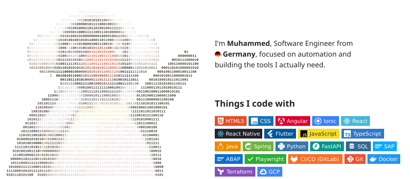

<h1> Hey! Nice to see you.</h1>

<picture>
  <source media="(prefers-color-scheme: dark)" srcset="assets/hero-dark.svg">
  
</picture>

<picture>
  <source media="(prefers-color-scheme: dark)" srcset="assets/home-dark.svg">
  
</picture>
